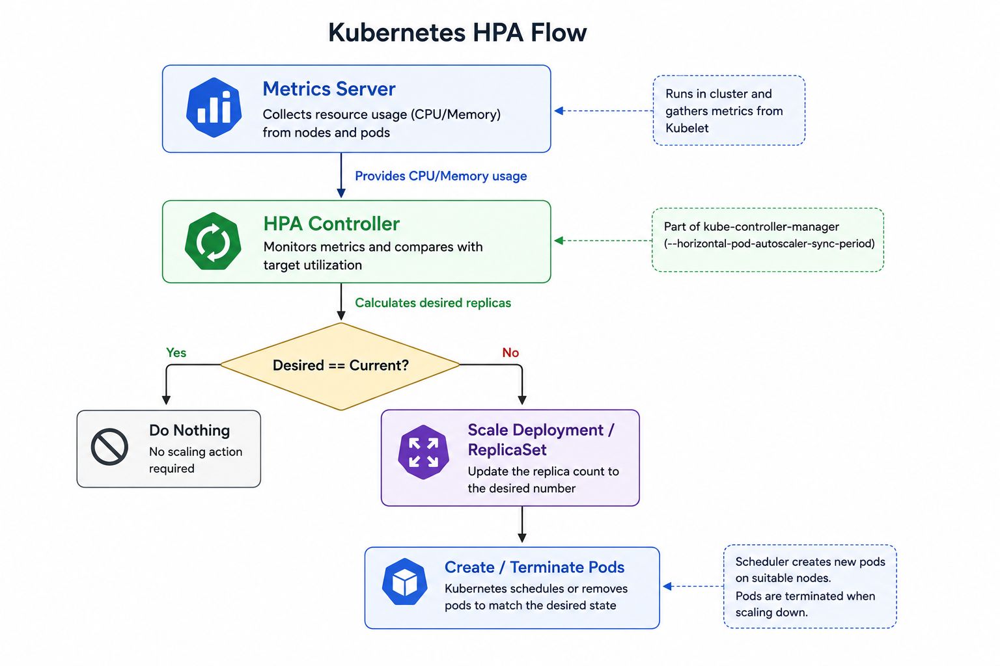

# Autoscaling in Kubernetes (HPA, VPA, and more)

> 📺 **Video Tutorial:** You can follow along with the concepts and hands-on demo in this [YouTube Tutorial on Kubernetes Autoscaling](https://www.youtube.com/watch?v=afUL5jGoLx0).

---

## What is Scaling?

Scaling is the process of changing your resources to meet user demand. 

In Kubernetes, you can scale manually by changing the `replicas` count in a Deployment. However, in production, monitoring and scaling workloads 24/7 manually is impossible. We need **Autoscaling** to automatically adjust resources based on metrics (like CPU or memory utilization) or external events.

### Horizontal vs. Vertical Scaling

Before diving into Kubernetes-specific tools, it's important to understand the two core types of scaling:

1. **Horizontal Scaling (Scale Out / Scale In):** 
   - Adding more identical copies (replicas) of your application when demand increases, and removing them when demand drops.
   - *Example:* Going from 1 Pod to 5 Pods.
2. **Vertical Scaling (Scale Up / Scale Down):** 
   - Resizing the existing machine or Pod to make it bigger (more CPU/Memory) or smaller.
   - *Example:* Changing a Pod's resource limits from 1 CPU / 1GB RAM to 10 CPU / 10GB RAM.
   - **Note:** Vertical scaling usually requires application restarts and minor downtime, so it's best for stateless apps that can afford it.

---

## Autoscaling Types in Kubernetes

Kubernetes handles scaling on two different levels: **Workload** (Pods) and **Infrastructure** (Nodes). 

| Type | Workload Level (Pods) | Infrastructure Level (Nodes) |
|------|------------------------|------------------------------|
| **Horizontal** | **HPA (Horizontal Pod Autoscaler)**<br>Adds more Pod replicas. *Built into Kubernetes.* | **Cluster Autoscaler**<br>Adds more Nodes (EC2, VMs) to the cluster. *Managed by Cloud Provider.* |
| **Vertical** | **VPA (Vertical Pod Autoscaler)**<br>Restarts Pods with higher CPU/Memory limits. *Requires separate installation.* | **Node Auto Provisioning**<br>Provisions larger Node pools dynamically. |

> 💡 **Other Scaling Tools:** 
> - **KEDA (Kubernetes Event-driven Autoscaling):** A CNCF tool that scales workloads based on *events* (e.g., messages in an AWS SQS queue, or a high number of HTTP 500 errors) rather than just CPU/Memory.

---

## Focus: Horizontal Pod Autoscaler (HPA)

Out of all the tools mentioned above, **HPA is the only one built directly into Kubernetes by default.**

The HPA operates in a continuous control loop. It checks the metrics of your Pods and adjusts the replicas to match your desired target (e.g., maintaining 50% CPU utilization).

<div align="center">
  
</div>

### Prerequisites: Installing the Metrics Server

For HPA to work, your cluster **must** have a Metrics Server installed to collect CPU and Memory data.

```bash
# Check if Metrics Server is running:
kubectl top nodes
```
If you get an error, install it directly from the official repository:
```bash
kubectl apply -f https://github.com/kubernetes-sigs/metrics-server/releases/latest/download/components.yaml
```

*(Minikube users: Run `minikube addons enable metrics-server`)*

---

## Hands-on: Seeing HPA in Action

Let's deploy a sample application, generate load, and watch the HPA automatically scale it up and down.

### 1. Deploy a Sample App (php-apache)
Create a file called `deploy.yaml` with both the Deployment and Service:

```yaml
apiVersion: apps/v1
kind: Deployment
metadata:
  name: php-apache
spec:
  selector:
    matchLabels:
      run: php-apache
  replicas: 1
  template:
    metadata:
      labels:
        run: php-apache
    spec:
      containers:
      - name: php-apache
        image: registry.k8s.io/hpa-example
        ports:
        - containerPort: 80
        resources:
          limits:
            cpu: 500m
          requests:
            cpu: 200m
---
apiVersion: v1
kind: Service
metadata:
  name: php-apache
  labels:
    run: php-apache
spec:
  ports:
  - port: 80
  selector:
    run: php-apache
```
Apply the file:
```bash
kubectl apply -f deploy.yaml
```

### 2. Create the HPA (Imperative)
We will tell the HPA to maintain an average CPU utilization of 50%, with a minimum of 1 pod and a maximum of 10.

```bash
kubectl autoscale deployment php-apache --cpu-percent=50 --min=1 --max=10
```
Verify the HPA:
```bash
kubectl get hpa
```
*(Initially, the `TARGETS` column might show `<unknown>/50%`. Wait a minute for the Metrics Server to collect data).*

### 3. Generate Load (In a New Terminal)
We will run a temporary `busybox` pod to send continuous requests to our application. Open a **new terminal window** and run:

```bash
kubectl run -i --tty load-generator --rm --image=busybox:1.28 --restart=Never -- /bin/sh -c "while sleep 0.01; do wget -q -O- http://php-apache; done"
```

### 4. Watch the HPA Scale Up
Go back to your original terminal and watch the HPA:

```bash
kubectl get hpa -w
```

Within a few minutes, you will see the CPU usage spike (e.g., `117%/50%`). The HPA will calculate the needed pods and increase the `REPLICAS` count. You will see it jump to 5, and potentially up to 7 or 10 depending on the load.

```bash
kubectl get pods
```

### 5. Watch the HPA Scale Down
Go to the terminal running the `load-generator` and press `Ctrl + C` to stop the load.

In the original terminal, continue watching the HPA (`kubectl get hpa -w`). 

The CPU utilization will drop back down to `0%/50%`. It won't downsize instantly. After a cooldown period (default 5 minutes to prevent thrashing), the HPA will automatically terminate the extra pods, safely scaling back down to 1 replica.

---

## Key Takeaways

| Practice | Why it's important |
|----------|-------------------|
| **Always Set Resource Requests** | HPA calculates utilization as a percentage of requested resources. Without requests, it cannot calculate CPU/Memory utilization. |
| **VPA requires restarts** | Unlike HPA which just adds more pods, VPA physically resizes the Pod, meaning the existing Pod must be terminated and recreated. |
| **Don't mix HPA and VPA on the same metrics** | If both try to scale based on CPU, they will conflict. |

---

**Next →** [Ingress and ALB Controller](./02-ingress-and-alb-controller.md)
